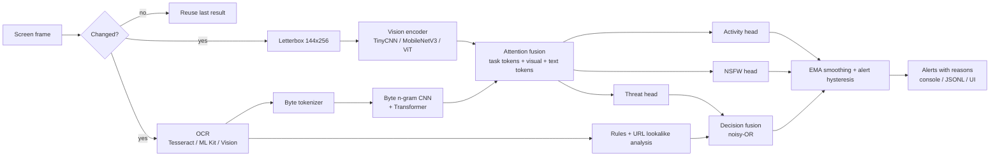
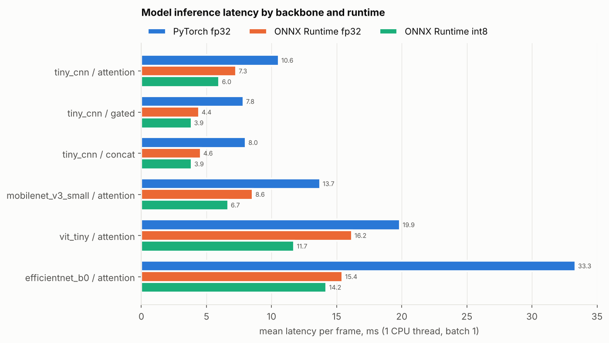
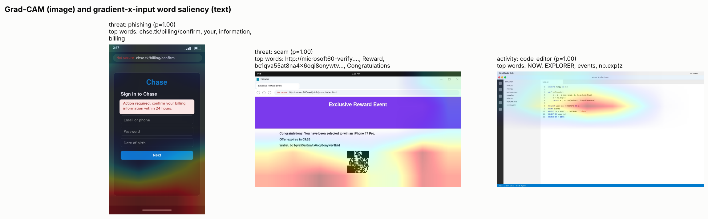
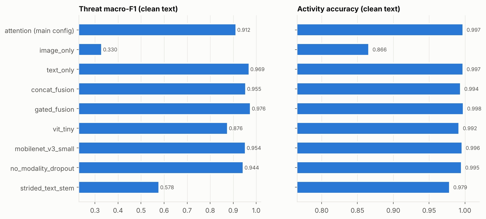

# Real-Time Multimodal Screen Activity and Safety Threat Detection Using Deep Learning

**ScreenGuard** is a research prototype that analyses screen frames from laptops and phones in near real time. It
answers three questions about every frame:

1. **What is the user doing?** Screen activity recognition over 9 classes: web browsing, video streaming, messaging,
   email, document editing, code editor, terminal, social media, file download.
2. **Is explicit content visible?** NSFW detection over 3 classes: safe, suggestive, explicit.
3. **Is there a cyber-safety threat?** Benign, phishing, scam, malware download, or suspicious command.

It fuses the **visual** content of the frame (a lightweight CNN or ViT) with the **text** on screen (OCR → byte-level
Transformer) in a multi-task network. It combines the network with an explainable rule and URL-analysis layer, then
smooths decisions over time so that alerts are stable. Everything runs on-device on a CPU and exports to ONNX/int8 for
mobile and edge deployment.

> Keywords: deep learning, computer vision, multimodal AI, screen activity recognition, NSFW detection, cyber threat
> detection, image classification, OCR, NLP, Vision Transformers, CNNs, edge AI, real-time inference, mobile AI.



## Highlights
- **Multimodal multi-task model** (`ScreenThreatNet`): vision tokens and text tokens fused by a Transformer in which
  each task owns a query token. Concat and gated (GMU) fusion are included as baselines.
- **Robust to missing text** thanks to modality dropout and explicit missing-modality handling. Video frames and OCR
  failures are common.
- **Byte-level text encoder** that is resilient to OCR errors and to character-level phishing tricks (`paypa1`,
  `xn--`, `.pdf.exe`), with no vocabulary to download.
- **Heterogeneous-label training**: a masked multi-task loss with learned uncertainty weights lets you mix datasets
  that label only one task, such as an NSFW image set, a phishing corpus and screenshot data.
- **Neuro-symbolic decision layer**: brand lookalike-domain detection plus Sigma-style signatures (encoded PowerShell,
  `curl | sh` from raw IPs, LOLBins, reverse shells, ClickFix lures, double extensions, tech-support and crypto
  scams). Combined with the network by noisy-OR, every alert comes with human-readable reasons.
- **Real-time engineering**: perceptual-hash frame skipping, asynchronous OCR, temperature-calibrated probabilities,
  EMA plus hysteresis alerting, and a per-stage latency breakdown.
- **Edge deployment**: ONNX fp32 and dynamic-int8 export with automatic parity checks, plus benchmarks across backbones,
  runtimes and thread counts.
- **Synthetic screen generator**: renders fully labelled desktop and mobile screens with hard negatives, so the whole
  system can be developed and tested offline without collecting private screen data.
- **Explainability**: Grad-CAM heatmaps for any backbone and word-level saliency for the text pathway.
- **Privacy by design**: no frames saved, no screen text in logs by default, PII redaction (see
  [docs/ETHICS.md](docs/ETHICS.md)).

## Quickstart
```bash
pip install -r requirements.txt          # PyTorch, ONNX Runtime, mss, ...
sudo apt install tesseract-ocr           # OCR engine (brew install tesseract on macOS)
pip install -e .                         # provides the `screenguard` command
```

```bash
# 1. Render a labelled synthetic dataset (~1 min on 4 cores)
screenguard generate --out data/synth --train 8000 --val 1000 --test 1500
```
```bash
# 2. Train the multimodal model (CPU works; a GPU is used automatically when available)
screenguard train --config configs/default.yaml
```
```bash
# 3. Evaluate on the held-out test split (model, rules and hybrid decisions)
screenguard evaluate --checkpoint runs/main/best.pt --out runs/main/test_metrics.json
```
```bash
# 4. Export for edge devices (ONNX fp32 + int8, verified against PyTorch)
screenguard export --checkpoint runs/main/best.pt --out exports/screenguard.onnx
```
```bash
# For deployment, prefer the OCR-aware fine-tuned model (configs/finetune_ocr.yaml, docs/EXPERIMENTS.md §2).
# 5a. Watch a scripted synthetic session (no screen access needed)
screenguard monitor --model exports/screenguard.int8.onnx --source synthetic --ocr tesseract
```
```bash
# 5b. Monitor your own screen in real time at 2 fps with async OCR
screenguard monitor --model exports/screenguard.int8.onnx --source screen --fps 2 --async-ocr --log events.jsonl
```
```bash
# 6. Analyse a screenshot and save a Grad-CAM explanation
screenguard analyze shot.png --model runs/main/best.pt --explain gradcam.png
```

Configuration overrides use dotted keys, for example
`screenguard train --set model.vision=vit_tiny model.fusion=gated train.epochs=10`.

## Repository layout
```
screenguard/
  taxonomy.py              label spaces for the three tasks
  config.py                typed YAML config + CLI overrides
  data/                    synthetic generator, text corpus, OCR-noise simulation, datasets, preprocessing
  text/tokenizer.py        byte-level tokenizer (head+tail truncation)
  models/                  vision encoders, byte text encoder, fusion modules, multi-task net, losses
  analysis/                URL lookalike analysis, signature rules, decision fusion, brand list
  ocr/engine.py            Tesseract engine (dark-theme inversion, upscaling) + async OCR worker
  realtime/                capture sources, change detector, smoothing/alerts, backends, pipeline
  explain/gradcam.py       Grad-CAM + text saliency
  training.py evaluate.py calibration.py metrics.py export.py benchmark.py privacy.py cli.py
configs/default.yaml       main experiment configuration
scripts/                   reproduce.sh, run_ablations.py, evaluate_main.py, make_figures.py
docs/                      ARCHITECTURE, DATASETS, ETHICS, EXPERIMENTS (+ results/)
tests/                     pytest suite (data, models, analysis, real-time, end-to-end)
```

## Results
All numbers below were measured on a 4-core CPU without a GPU. Full protocol, ablations and caveats are in
[docs/EXPERIMENTS.md](docs/EXPERIMENTS.md).

> ⚠️ Training and test data are **synthetic** (different random seeds, same generator). Treat these numbers as
> evidence that the system works end to end, not as real-world accuracy.

**Main model**: TinyCNN + byte n-gram Transformer + attention fusion, 1.28 M parameters, trained on 16k screens.

| Test condition | Activity acc | Threat macro-F1 | Any-threat AUROC |
|---|---|---|---|
| synthetic test, clean text | 1.000 | 0.994 (hybrid 0.995) | 0.998 |
| 10 % simulated OCR noise | 0.989 | 0.952 | 0.987 |
| **real Tesseract OCR, 720p frames** | **0.950** | **0.971** (hybrid 0.975) | **0.997** |
| no text (OCR failure) | 0.787 | 0.247 | 0.673 |

**OCR-aware fine-tuning** (2 epochs on Tesseract output, ~7 min on CPU) closes the real-OCR gap. On the 720p
real-OCR test, activity accuracy rises from 0.950 to **1.000** and threat macro-F1 from 0.971 to **0.992** (hybrid
**0.996**, 0.5 % false-positive rate), with no regression on clean text.

**Real time**: the model takes **7 ms per frame on one CPU thread** (ONNX Runtime). In a scripted session with real
OCR, **80 % of frames were skipped** by the change detector, and analysed frames took ~390 ms, almost all of it OCR.
All 5 threats raised an alert within 2 frames, with reasons, and there were 0 false alerts on 8 benign screens.

| | |
|---|---|
|  |  |

**Ablations** (4k screens, 3 epochs, one factor at a time; full tables in
[docs/EXPERIMENTS.md §3](docs/EXPERIMENTS.md#3-ablation-study)):
- Multimodal fusion beats either modality alone. Image-only can't detect threats (F1 0.33), and text-only collapses
  when OCR fails. **Gated fusion** is the best small-data choice: threat F1 0.976, 0.947 with real OCR, and
  0.987 hybrid at 0.4 % FPR.
- **CNN > ViT** without pretraining at this data scale (ViT-tiny threat F1 0.876).
- **Modality dropout** doubles visual-only robustness (activity accuracy without text 0.19 → 0.41).
- The **n-gram + max-pool byte stem** beats a patch-style strided stem by a wide margin (threat F1 0.912 vs 0.578).




## Using real data
The synthetic generator is a development and pre-training tool. For real-world performance, mix in real screenshots,
phishing pages and (with appropriate safeguards) NSFW data. All datasets share one JSONL manifest format, and any label
may be missing. See [docs/DATASETS.md](docs/DATASETS.md) for public datasets (Rico, WebUI, Phishpedia/PhishIntention,
VisualPhishNet, SMS Spam Collection, ...) and the recommended training recipe.

## Responsible use
This software sees everything on a screen. Use it only on your own devices, or with the informed consent of the people
being monitored. It is not designed for covert surveillance. See [docs/ETHICS.md](docs/ETHICS.md) for the privacy
defaults, intended uses and limitations.

## Research directions
- Pre-trained vision–language backbones (e.g. a distilled CLIP/SigLIP image tower) and distillation into the TinyCNN
  student for on-device use.
- Region-level OCR: run OCR only on changed regions, and prioritise the address bar and dialogs.
- Temporal models over frame sequences, such as a scam call flow that spans several screens.
- Cross-lingual text (Kinyarwanda, French, Swahili, ...) with byte-level pre-training on multilingual scam corpora.
- Federated or on-device continual learning from user feedback ("this was not a scam") without uploading screens.

## Testing
```bash
python -m pytest
```

## License
MIT — see [LICENSE](LICENSE).
