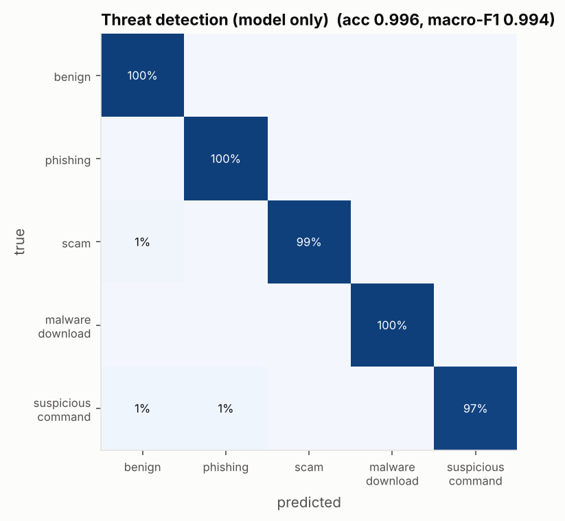
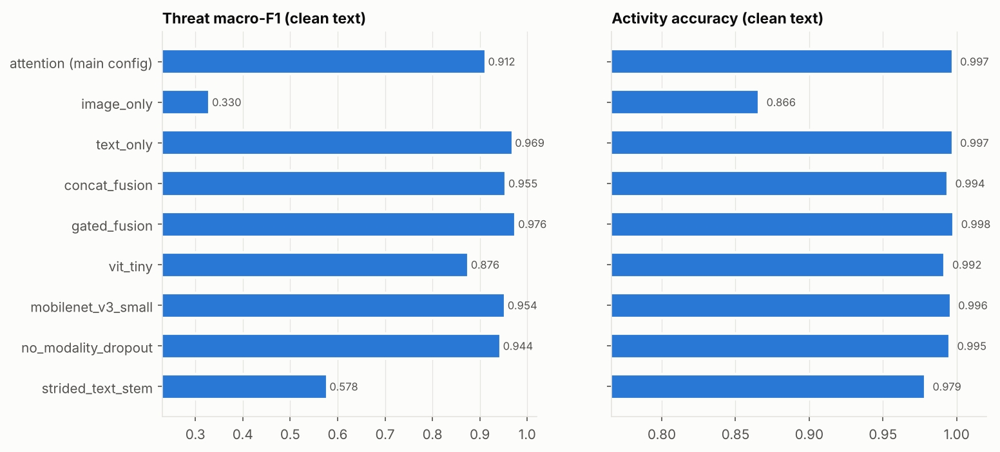
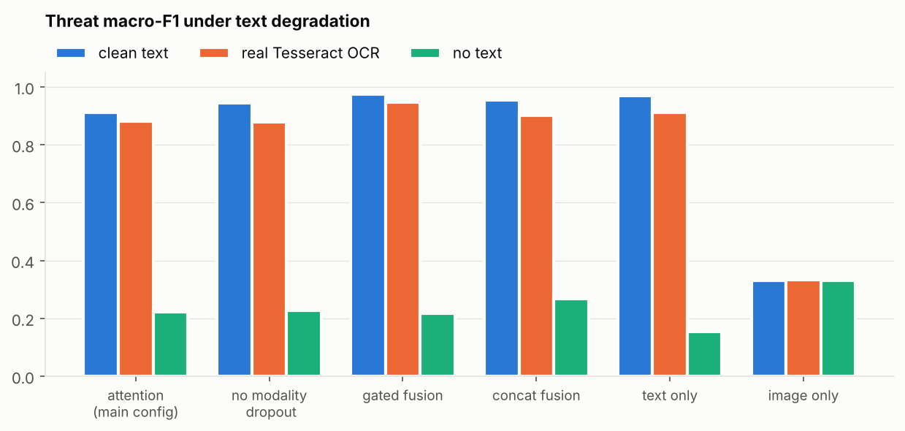
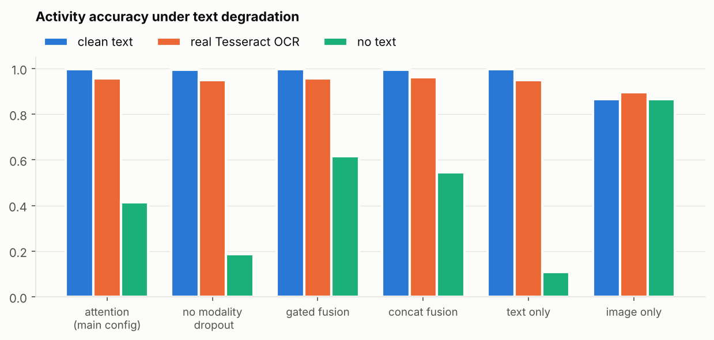

# Experiments

All numbers in this file were produced by the scripts in this repository on a **4-core CPU without a GPU**.
[`scripts/reproduce.sh`](../scripts/reproduce.sh) regenerates all of them with the exact seeds used. Raw JSON results live in [`docs/results/`](results/) and figures in
[`docs/figures/`](figures/).

> **Read these numbers as a sanity check of the system, not as real-world performance.** All train and test screens
> come from the same synthetic generator, and the signature rules were written by the same author as the synthetic
> text templates. Both the model scores and especially the rules-only scores are therefore optimistic. The protocol
> below is what should be re-run on real data (see [DATASETS.md](DATASETS.md)).

## Setup
| | |
|---|---|
| Data | synthetic, 640×360 desktop / 360×640 mobile (≈13 % mobile). Train 16 000 (main model) or 4 000 (ablations), val 1 000, test 1 500, each split from a different seed |
| Text | ground-truth visible text in reading order. During training, 3 % simulated OCR character noise |
| Input | letterboxed 144×256 RGB, byte text up to 1 024 bytes (head + tail truncation) |
| Optimiser | AdamW, lr 2e-3, weight decay 0.05, 5 % warm-up then cosine, batch 64, label smoothing 0.05, grad-clip 1.0 |
| Loss | masked multi-task CE with learned uncertainty weights |
| Calibration | per-task temperature fitted on val |
| Metrics | accuracy, macro-F1, expected calibration error (ECE). For threats also binary any-threat AUROC, recall/FPR at 0.5, and TPR at 1 % FPR |


## 1. Main model
`configs/default.yaml`: TinyCNN + byte n-gram CNN/Transformer + attention fusion, **1.28 M parameters**, trained on
16 000 screens for 6 epochs (29 min on the CPU).

```bash
screenguard train --config configs/default.yaml
python scripts/evaluate_main.py --checkpoint runs/main/best.pt
```

### 1.1 Held-out synthetic test set (1 500 screens)
| Condition | Activity acc | Threat acc | Threat macro-F1 | Any-threat AUROC | TPR @ 1 % FPR | Threat ECE |
|---|---|---|---|---|---|---|
| clean text | **1.000** | **0.996** | **0.994** | 0.998 | 0.993 | 0.003 |
| 5 % OCR noise | 0.998 | 0.988 | 0.985 | 0.996 | 0.977 | 0.011 |
| 10 % OCR noise | 0.989 | 0.963 | 0.952 | 0.987 | 0.926 | 0.032 |
| 20 % OCR noise | 0.953 | 0.880 | 0.832 | 0.943 | 0.713 | 0.107 |
| no text (OCR failure) | 0.787 | 0.626 | 0.247 | 0.673 | 0.033 | 0.164 |

Per-class F1 on clean text: phishing 0.991, scam 0.994, malware download 1.000, suspicious command 0.985, benign
0.998. Desktop (1 299 screens) and mobile (201) performance is the same.

Observations:
* **Graceful degradation under OCR noise.** At a 10 % character error rate, threat F1 drops by only 4 points. This
  comes from the byte-level encoder plus OCR-noise augmentation during training.
* **Threat detection is fundamentally textual.** Without text, threat F1 collapses to 0.25, and only visually
  distinctive threats such as full-screen tech-support warnings remain detectable. Activity recognition keeps 79 %
  accuracy from pixels alone. Reliable OCR is therefore a hard requirement for the threat task.

### 1.2 Decision fusion: model vs rules vs hybrid (threat macro-F1)
| Condition | Model only | Rules only | Hybrid (noisy-OR) | Hybrid FPR | Hybrid recall |
|---|---|---|---|---|---|
| clean text | 0.994 | 0.867 | **0.995** | 0.11 % | 99.8 % |
| 5 % OCR noise | **0.985** | 0.715 | 0.974 | 1.7 % | 97.7 % |
| 10 % OCR noise | **0.952** | 0.524 | 0.942 | 2.6 % | 93.5 % |
| 20 % OCR noise | **0.832** | 0.289 | 0.829 | 6.0 % | 80.6 % |
| real Tesseract OCR (720p) | 0.971 | 0.804 | **0.975** | 1.1 % | 98.2 % |

* Regex rules are **brittle under OCR noise**: they fall from 0.87 to 0.29 at 20 % noise, while the learned model
  keeps 0.83.
* The hybrid wins on clean and real-OCR text, and its main value is **explanations**: every alert lists the rule and
  URL reasons behind it. Under heavy synthetic noise, rule false positives make the hybrid slightly worse than the
  model alone. A deployment should therefore tune `rule_scale` (in `fuse_threat`) on its own OCR engine's output.
* Rules-only scores on synthetic data are optimistic, because the rules and the text templates share an author.

### 1.3 Real OCR instead of ground-truth text (300 frames at 1280×720)
Tesseract 5.3 (`--psm 11`, dark-theme inversion, upscaling) reaches a mean character similarity of **0.854** to the
ground-truth text, at **374 ms** per frame on average (p95 625 ms) with 4 OCR processes in parallel.

| Text source | Activity acc | Threat macro-F1 | Any-threat AUROC |
|---|---|---|---|
| ground-truth text | 1.000 | 1.000 | 1.000 |
| Tesseract OCR | 0.950 | 0.971 | 0.997 |

The OCR gap is concentrated in specific classes: **terminal** activity recall falls to 0.70, document editing to
0.86, and suspicious-command recall to 0.89. Tesseract turns dark-theme shell prompts such as `user@host:~/project$`
into fragments (`admir`, `rminal`) that the model never saw in training. Section 2 closes this gap with OCR-aware
fine-tuning.




## 2. OCR-aware fine-tuning (closing the real-OCR gap)
The main model was trained on ground-truth screen text. To adapt it to the deployed OCR engine, 3 000 additional
1280×720 screens were rendered (new seed) and run through Tesseract. The model was then fine-tuned from
`runs/main/best.pt` for 2 epochs at lr 5e-4, on 2 500 of them (Tesseract text) mixed with 8 000 original screens
(ground-truth text). The remaining 500 joined the validation set. Evaluation uses the separate, unseen 300-frame 720p
test set from §1.3.

```bash
# data + OCR steps: see scripts/reproduce.sh (seed 606, 1280x720, Tesseract, 2500/500 split)
screenguard train --config configs/finetune_ocr.yaml
python scripts/evaluate_main.py --checkpoint runs/ocr_finetune/best.pt --out docs/results/ocr_finetune
```

| 720p test with **real Tesseract OCR** | Main model | + OCR-aware fine-tune |
|---|---|---|
| Activity accuracy | 0.950 | **1.000** |
| — terminal recall | 0.704 | **1.000** |
| — document-editing recall | 0.861 | **1.000** |
| Threat macro-F1 (model) | 0.971 | **0.992** |
| — suspicious-command recall | 0.889 | **1.000** |
| Threat macro-F1 (hybrid) | 0.975 | **0.996** |
| Any-threat false-positive rate (hybrid) | 1.07 % | **0.53 %** |
| Synthetic test, clean text: threat macro-F1 | 0.994 | 0.993 |
| Synthetic test, 20 % OCR noise: threat macro-F1 | 0.832 | 0.857 |

Fine-tuning on the deployed OCR engine's output **closes the OCR gap with no regression on clean text**, at a cost
of only ~7 minutes of CPU training. This is the single most important step when moving to a new OCR engine, for
example Android ML Kit or Apple Vision on phones. `exports/screenguard_ocrft.onnx` is the recommended deployment
model. The caveat is that the fine-tuning and test screens come from the same generator, so on real screens the same
recipe must be applied with real OCR'd frames.


## 3. Ablation study
Each variant changes one factor of the main configuration. All variants share a deliberately small budget, **4 000
training screens and 3 epochs from scratch**, so that differences are not hidden by saturation. Each is evaluated on
the 1 500-screen synthetic test set (clean text, 10 % OCR noise, no text) and on the 300-frame 720p set with real
Tesseract OCR. Each variant was trained once (one seed), so treat differences under ~0.02 as noise.

```bash
python scripts/run_ablations.py --epochs 3   # ~25 min on 4 CPU cores
```

| Variant | Params | Activity acc | Threat F1 | Threat AUROC | Activity acc (real OCR) | Threat F1 (real OCR) | Threat F1 (10 % OCR noise) | Activity acc (no text) | Threat F1 (no text) |
|---|---|---|---|---|---|---|---|---|---|
| attention (main config) | 1.28 M | 0.997 | 0.912 | 0.986 | 0.957 | 0.881 | 0.822 | 0.414 | 0.222 |
| image_only | 0.79 M | 0.866 | 0.330 | 0.726 | 0.897 | 0.335 | 0.330 | 0.866 | 0.330 |
| text_only | 0.94 M | 0.997 | 0.969 | 0.997 | 0.950 | 0.911 | 0.888 | 0.109 | 0.153 |
| concat_fusion | 0.92 M | 0.994 | 0.955 | 0.995 | 0.963 | 0.902 | 0.906 | 0.547 | 0.268 |
| gated_fusion | 0.95 M | 0.998 | 0.976 | 0.998 | 0.957 | 0.947 | 0.908 | 0.617 | 0.218 |
| vit_tiny | 2.92 M | 0.992 | 0.876 | 0.981 | 0.927 | 0.801 | 0.793 | 0.265 | 0.153 |
| mobilenet_v3_small | 1.94 M | 0.996 | 0.954 | 0.995 | 0.937 | 0.922 | 0.876 | 0.106 | 0.153 |
| no_modality_dropout | 1.28 M | 0.995 | 0.944 | 0.990 | 0.950 | 0.879 | 0.861 | 0.186 | 0.228 |
| strided_text_stem | 1.50 M | 0.979 | 0.578 | 0.848 | 0.803 | 0.495 | 0.551 | 0.617 | 0.192 |

Decision fusion on clean text. Rules-only is the same for every variant (F1 0.867):

| Variant | Rules-only threat F1 | Hybrid threat F1 | Hybrid FPR |
|---|---|---|---|
| attention (main config) | 0.867 | 0.947 | 0.048 |
| image_only | 0.867 | 0.834 | 0.233 |
| text_only | 0.867 | 0.980 | 0.013 |
| concat_fusion | 0.867 | 0.975 | 0.025 |
| gated_fusion | 0.867 | 0.987 | 0.004 |
| vit_tiny | 0.867 | 0.930 | 0.051 |
| mobilenet_v3_small | 0.867 | 0.976 | 0.007 |
| no_modality_dropout | 0.867 | 0.970 | 0.023 |
| strided_text_stem | 0.867 | 0.842 | 0.162 |





**Findings**
1. **Multimodal beats either modality alone, if fused well.** Image-only cannot detect threats (F1 0.33), and
   text-only collapses when OCR fails (activity 0.11 without text). Gated fusion is the best model at this budget:
   threat F1 0.976 on clean text and 0.947 with real OCR, and in hybrid mode 0.987 at a 0.4 % false-positive rate.
2. **Attention fusion is data-hungry.** With 4k screens and 3 epochs it trails gated and concat fusion (0.912). With 16k
   screens and 6 epochs (§1) it reaches 0.994. For very small datasets, use `fusion=gated`, which is also ~40 % faster
   (§4).
3. **CNN > ViT at this data scale.** ViT-tiny (2.9 M params) is the weakest image backbone (threat F1 0.876, real-OCR
   activity 0.927) and the slowest. This is the expected result for ViTs without pretraining or large data.
   MobileNetV3-Small does better than TinyCNN on threats at this budget (0.954 vs 0.912), but its encoder is 3× larger
   (1.0 M vs 0.34 M) and the model is ~18 % slower. With more data (§1), TinyCNN already saturates the synthetic
   task, so the backbone choice should be revisited on real screens.
4. **Modality dropout fights "modality laziness".** Without modality dropout, the multimodal model leans almost
   entirely on text: activity accuracy with no text is 0.19. Dropout more than doubles that to 0.41, at a small cost on
   clean text (0.944 → 0.912 threat F1 at this budget). The weak no-text numbers of all fusion models show the
   known tendency of multimodal networks to under-use the weaker modality. Stronger remedies, such as higher
   dropout, auxiliary unimodal heads, or gradient modulation, are listed as future work.
5. **The text stem matters most.** The patch-style strided byte stem reaches only 0.578 threat F1 against 0.912 for
   the n-gram + max-pool stem, with the same data and epochs. The difference is shift invariance.
6. **The hybrid helps every reasonable model.** Rules add the most to weaker models (+0.035 for attention at this
   budget), but they also amplify a bad model's false positives (image-only: 23 % FPR).


## 4. Real-time performance
```bash
screenguard benchmark --variants tiny_cnn/attention tiny_cnn/gated tiny_cnn/concat mobilenet_v3_small/attention vit_tiny/attention efficientnet_b0/attention --threads 1 4
```

Mean latency per frame (batch 1, input 144×256 plus 1 024 text bytes). Measured with random but symmetry-broken
weights, whose file sizes match the trained exports.

| Model | Threads | Params | ONNX fp32 / int8 size | PyTorch ms | ONNX fp32 ms | ONNX int8 ms |
|---|---|---|---|---|---|---|
| tiny_cnn / attention | 1 | 1.28 M | 5.1 / 2.8 MB | 10.6 | 7.3 | 6.0 |
| tiny_cnn / attention | 4 | 1.28 M | 5.1 / 2.8 MB | 7.8 | 4.5 | 4.1 |
| tiny_cnn / gated | 1 | 0.95 M | 3.7 / 2.3 MB | 7.8 | 4.4 | 3.9 |
| tiny_cnn / gated | 4 | 0.95 M | 3.7 / 2.3 MB | 6.0 | 2.8 | 2.8 |
| tiny_cnn / concat | 1 | 0.92 M | 3.6 / 2.3 MB | 8.0 | 4.6 | 3.9 |
| tiny_cnn / concat | 4 | 0.92 M | 3.6 / 2.3 MB | 6.4 | 3.0 | 2.8 |
| mobilenet_v3_small / attention | 1 | 1.94 M | 7.6 / 5.3 MB | 13.7 | 8.6 | 6.7 |
| mobilenet_v3_small / attention | 4 | 1.94 M | 7.6 / 5.3 MB | 9.6 | 4.7 | 4.7 |
| vit_tiny / attention | 1 | 2.92 M | 11.4 / 4.1 MB | 19.9 | 16.2 | 11.7 |
| vit_tiny / attention | 4 | 2.92 M | 11.4 / 4.1 MB | 9.2 | 8.1 | 6.9 |
| efficientnet_b0 / attention | 1 | 5.11 M | 19.7 / 17.4 MB | 33.3 | 15.4 | 14.2 |
| efficientnet_b0 / attention | 4 | 5.11 M | 19.7 / 17.4 MB | 16.0 | 8.6 | 8.0 |

Pipeline stages on a 1280×720 frame:

| Stage | mean ms | p95 ms |
|---|---|---|
| change_detector | 3.43 | 4.01 |
| preprocess_letterbox | 1.52 | 1.62 |
| tokenize | 0.02 | 0.03 |
| rules_and_urls | 1.28 | 1.30 |
| ocr_tesseract_720p | 333.72 | 339.57 |


* The model is cheap: **7.3 ms (fp32) / 6.0 ms (int8) on one thread** for the main model, and 3.9 ms for gated fusion.
  That is over 100 frames per second of model capacity on a single core.
* OCR costs about 45× the model. Skipping unchanged frames and running OCR asynchronously matter more for battery and
  latency than any model optimisation.


### End-to-end session (`screenguard monitor --source synthetic:5 --ocr tesseract`)
This scripted session has 13 screens, each shown for 5 frames: 8 benign screens and 5 threats. Full output is in
[`results/monitor_demo.txt`](results/monitor_demo.txt).

* **52 of 65 frames (80 %) were skipped** as unchanged: no OCR and no model call, ~3 ms each.
* Changed frames cost 392 ms on average. **OCR accounts for 378 ms of that, the model for 6.8 ms**, preprocessing for
  3 ms, and rules for 0.9 ms.
* **All 5 threats raised an alert** (phishing email, malicious shell commands, giveaway scam, malware download,
  phishing login), each 2 frames after it appeared, as required by the hysteresis `min_on=2`. Each alert came with
  reasons, e.g. *"coinbase1-support.net: mentions 'Coinbase' but is not an official Coinbase domain"*. There were
  **0 false alerts** on the 8 benign screens, and every alert cleared 2 frames after its screen went away.
* With `--async-ocr`, the visual pathway runs at the capture rate regardless of OCR, and text-based verdicts follow
  one OCR cycle (~0.4 s) later.

### Export
| Artifact | Size | Max abs. logit diff vs PyTorch | Arg-max agreement |
|---|---|---|---|
| ONNX fp32 | 5.07 MB | 4 × 10⁻⁶ | 100 % |
| ONNX int8 (MatMul/Gemm weights) | 2.77 MB | 0.056 | 100 % |

## 5. Engineering findings worth knowing
1. **Byte-text stem.** The first version of the text encoder used one strided convolution (kernel 16, stride 8). It
   must learn every keyword separately for each of 8 alignments. Replacing it with a stride-1 n-gram convolution
   plus max-pooling, which is shift-invariant, raised text-only threat F1 after 3 epochs on 2 000 screens from 0.36 to
   0.57, and activity accuracy from 88 % to 99 %, at the same cost. Section 3 shows the effect at full scale.
2. **Temperature scaling on a saturated validation set is ill-posed.** With ~100 % validation accuracy, NLL keeps
   falling as T → 0 (the fit returned T = 0.08). That would make the model extremely over-confident on real,
   out-of-distribution screens, so temperatures are clamped to [0.25, 10].
3. **Frame skipping must still feed the temporal logic.** An early version skipped unchanged frames entirely, so a
   static phishing page contributed only one observation and never satisfied the "2 consecutive frames" alert rule.
   Unchanged frames now re-feed the cached prediction into the smoother and alert state machine.
4. **Alert cooldowns must be per label.** A global cooldown suppressed alerts for a malicious command and a scam page because a
   phishing alert had fired shortly before.
5. **int8 is not automatically faster.** ONNX Runtime's default dynamic quantisation also converts convolutions, and
   on this x86 CPU `ConvInteger` made the model **2–3× slower** than fp32. Quantising only MatMul/Gemm keeps
   accuracy (100 % arg-max agreement), shrinks the file 1.8×, and is 10–28 % faster on one thread. The gain is largest
   for the Transformer-heavy ViT. Larger gains need static QDQ quantisation, or ARM CPUs with int8 dot-product
   instructions.
8. **Benchmark freshly initialised models with care.** `nn.TransformerEncoder` deep-copies one layer N times, so
   untrained models have identical layer weights. The ONNX exporter then de-duplicates them, giving a smaller,
   cache-friendlier and unrealistically fast graph. The benchmark perturbs weights to avoid this.
6. **PyTorch eager dynamic quantisation breaks `nn.TransformerEncoder`.** The quantised `Linear.weight` becomes a
   method, which trips the encoder's fast-path checks, and the API is being deprecated. ONNX Runtime is the
   recommended quantised path.
7. **Tesseract OCR should run single-threaded** (`OMP_THREAD_LIMIT=1`) next to the model or in parallel workers.
   Otherwise OpenMP oversubscription made individual calls exceed 20 s under load.

